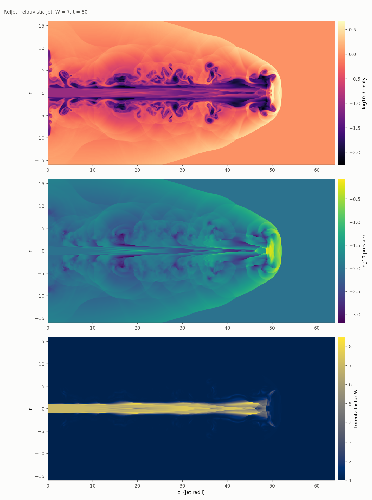
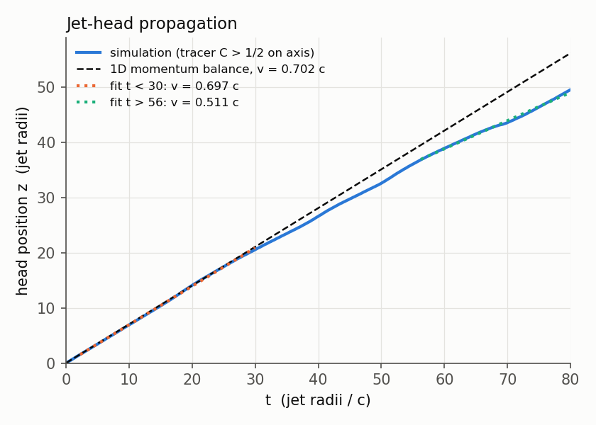
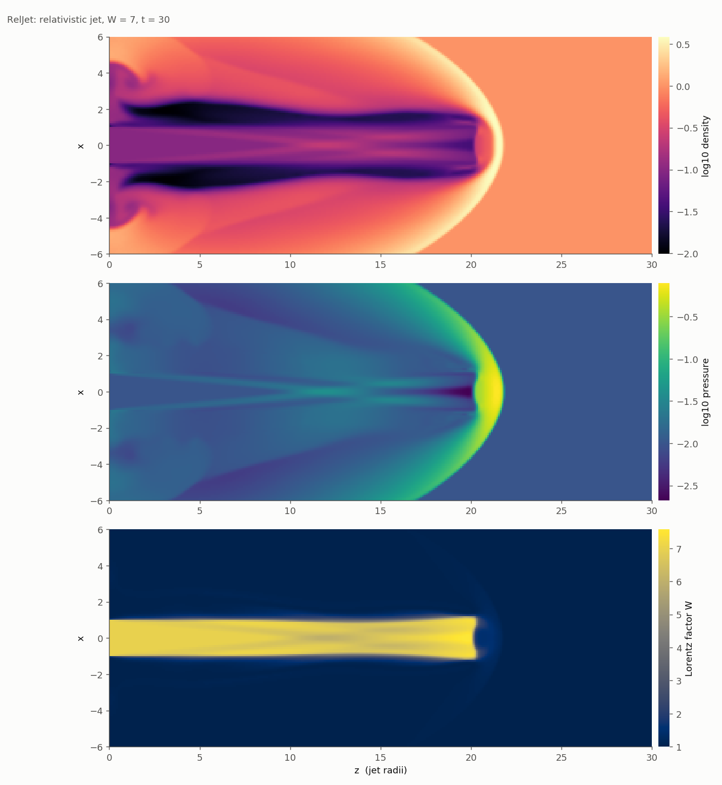
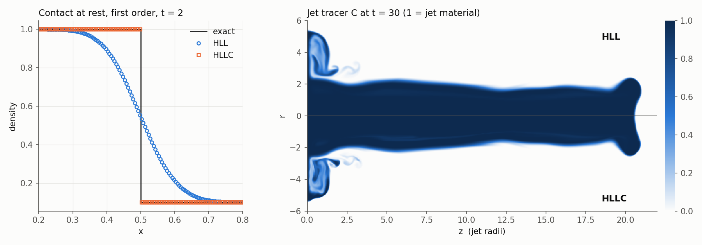
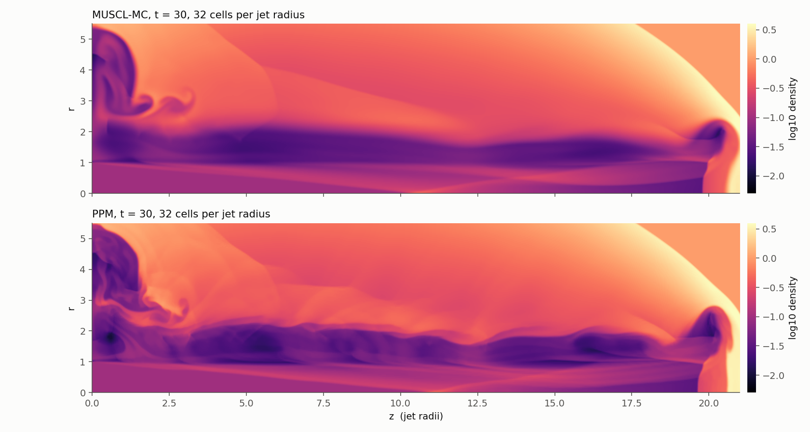
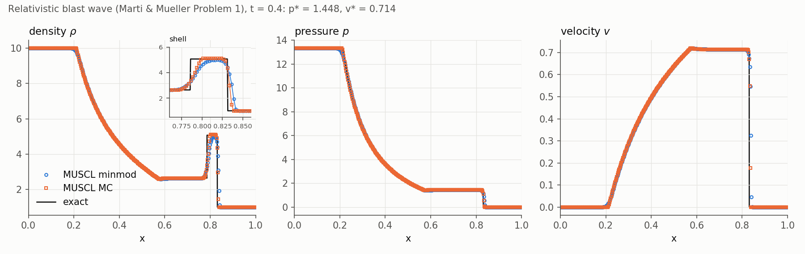
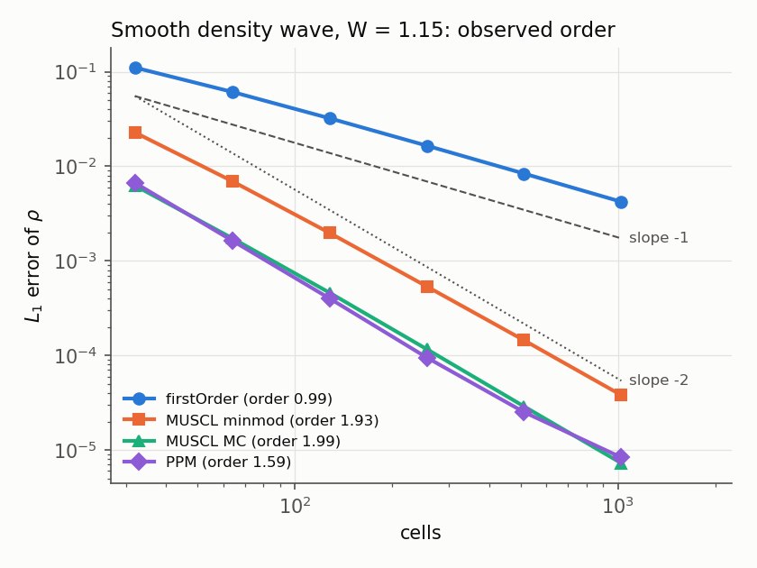

# RelJet

**Special-relativistic hydrodynamics on CPU and GPU, from the equations to an astrophysical jet.**

RelJet is a compact finite-volume solver for ideal special-relativistic
hydrodynamics (SRHD), written from scratch in C++17 with a native CUDA backend.
It follows a relativistic jet, a beam of gas moving at 99 % of the speed of
light, as it drills through a uniform medium: the beam inflates a hot cocoon,
drives a bow shock ahead of it and is pinched by recollimation shocks along
its length.

<p align="center">
  
</p>

<p align="center"><em>Rest-mass density (log scale) of a Lorentz factor 7 jet,
mirrored about its axis: 1 million cells, 2D axisymmetric, 9.6 minutes on one
Tesla T4.</em></p>

## Highlights

- **SRHD in conservative form** for (D, S, τ, DC), evolving τ = E − D, so that
  cold or slow gas loses no digits to cancellation.
- **MUSCL or PPM with HLL or HLLC, and SSP-RK2**: piecewise-linear (minmod or
  MC limiter) or piecewise-parabolic reconstruction, flattened to MUSCL at
  strong shocks. HLLC resolves contact discontinuities exactly and
  falls back to HLL near shocks, detected in every direction. Reconstructed
  face states are checked for admissibility, and any first-order fallback is
  counted.
- **Robust primitive recovery**: a safeguarded Newton iteration on the
  pressure, with explicit tolerances, an iteration cap and status codes. A
  failure stops the run and names the cell; nothing is patched silently.
- **1D, 2D and 3D Cartesian, plus 2D axisymmetric (r, z)** with ring-area
  weighting and well-balanced geometric source terms.
- **One set of equations, two backends.** Every per-cell and per-face
  operation lives once, in [`Kernels.H`](src/solver/Kernels.H). The OpenMP CPU
  solver and the CUDA solver only decide how to loop over it, and they agree
  to round-off (about 1e-13).
- **Verified**: exact Riemann solution, a measured second-order convergence
  rate, the analytic jet-head speed, conservation to 1e-13, and 82 unit tests
  (5 of them compare the GPU with the CPU).
- **OpenFOAM-style cases**: dictionaries in `system/` and `constant/`, with
  `Allrun` and `Allclean` scripts. Output is VTK for ParaView or VisIt.
- **No dependencies** beyond CMake, a C++17 compiler and, optionally, OpenMP
  and CUDA. The plotting scripts need only numpy and matplotlib.

## Results

### The jet

<p align="center">
  
</p>

The case is `tutorials/axisymmetricJet`, in the spirit of Martí et al. (1997):
- **Beam:** Lorentz factor W = 7 (v = 0.9897 c), density contrast
  η = ρ_beam/ρ_ambient = 0.1, pressure matched with the ambient medium
  (p = 0.01 ρ_ambient c²), γ = 5/3.
- **Resolution:** 32 cells per jet radius.

The pressure panel shows the bow shock, the shocked cocoon and the diamond
pattern of the recollimation shocks inside the beam. The Lorentz factor shows
the beam keeping W ≈ 7 almost up to the terminal shock (the Mach disk), where
it is decelerated.

<p align="center">
  
</p>

A one-dimensional momentum balance at the jet head predicts how fast the head
advances: v_head = v_b √η_R / (1 + √η_R), with η_R = ρ_b h_b W² / (ρ_a h_a).
For these parameters it gives 0.702 c.

For t < 30 the simulated head moves at **0.697 c, within 1 % of the estimate**.
After that it slows to about 0.51 c. The estimate assumes the working surface
is one beam radius wide, but the head then broadens into a mushroom about four
radii across (visible in the density panel), so it pushes against more ambient
gas. By t ≈ 60 the bow shock reaches the outer boundary at r = 16 near the
inlet. That boundary is an outflow condition, but a production study would use
a wider domain.

### The same jet in 3D

<p align="center">
  
</p>

`tutorials/jet3D` runs the same beam on a 3D Cartesian grid (120 × 120 × 300 =
4.3 M cells, 10 cells per jet radius); the figure is the slice y = 0. On the
T4 it ran to t = 30 in 8.7 minutes. The head advances at 0.687 c, within 2 % of
the estimate. At this resolution the shear layers stay smooth, and the
non-axisymmetric instabilities that 3D allows would need a finer grid and a
longer run to develop.

### HLL against HLLC

<p align="center">
  
</p>

HLL keeps only the two fastest waves of each Riemann problem and averages
everything between them, so it smears contact discontinuities. HLLC (Mignone &
Bodo 2005) restores the contact. `tutorials/fluxComparison` runs both on the
same cases:

| case | HLL | HLLC |
|---|---|---|
| contact at rest, first order, 200 cells, t = 2: smeared cells | 80 | **0** |
| Problem 1: largest density difference between the two | | 0.0024 |
| jet (32 cells/radius, t = 30): mixed volume (0.05 < C < 0.95) / jet volume | 0.613 | 0.580 |
| jet: head position at t = 30 | 20.56 | 20.56 |
| jet: run time, 16 threads | 85 s | 107 s |

HLLC holds a contact at rest exactly, but helps little where contacts move
fast. At the contact of Problem 1 every wave travels in the same direction,
so both solvers return the same upwind flux. In the jet, HLLC reduces the
mixed volume by about 5 %, at about 25 % more run time.

HLLC needs care here. With only a face-normal pressure-jump test, the
jet crashes in its first steps at the nozzle lip. There, a strong axial shock
runs *along* the radial faces, where the pressure on both sides is still
equal. RelJet therefore uses HLLC only on faces whose two cells are away from
a shock in every direction (a pressure jump above 10 % to any neighbour),
similar to multidimensional shock flattening in PLUTO. HLL remains the
default.

### MUSCL against PPM

<p align="center">
  
</p>

PPM (Colella & Woodward 1984) builds a parabola in each cell from a
fourth-order face interpolation, then limits it so that it creates no new
extrema. Next to strong shocks (a pressure jump above 50 % to any neighbour)
RelJet flattens it to MUSCL-MC: plain PPM crashes the jet at 8 and 16 cells
per radius, at the shocks near the nozzle. With HLL:

| case | MUSCL-MC | PPM |
|---|---|---|
| moving contact (v = 0.5), smeared cells | 10 | **7** |
| Problem 1, L1(ρ) at 400 cells | 0.0342 | **0.0280** |
| jet (32 cells/radius, t = 30): mixed volume / jet volume | 0.613 | **0.461** |
| jet: run time, 16 threads | 85 s | 157 s |

PPM resolves the cocoon's Kelvin–Helmholtz vortices that MUSCL-MC smears out,
and keeps the jet material about 25 % less mixed. It reads five cells per face
instead of three, and costs about 1.8 times as much.

### Verification

<p align="center">
  
</p>

**Relativistic blast wave** (Martí & Müller 2003, Problem 1; `tutorials/riemannProblem1`).
At 400 cells the solution matches the exact one from
[`riemannExact.py`](scripts/riemannExact.py): p* = 1.448, v* = 0.714, and a
thin shell compressed to ρ = 5.07. The inset shows the shell. The MC limiter
resolves it in a few cells, while minmod smears it.

<p align="center">
  
</p>

**Order of accuracy** (`convergenceStudy`). A smooth density wave advected at
v = 0.5 c is an exact solution of SRHD. The L1 error falls at the designed
rate:

| scheme | observed order (512 → 1024 cells) |
|---|---|
| first order | 0.99 |
| MUSCL minmod | 1.93 |
| MUSCL MC | 2.00 |
| PPM | 1.59 |

Minmod stays slightly below 2 because it flattens the slope at every smooth
extremum. PPM is not third order here, for two reasons. SSP-RK2 limits the
time error to second order. The PPM limiter also flattens every extremum,
including the crests of the sine. Without its limiter PPM reaches order 4 at
a small CFL number. Its error is still the smallest up to 512 cells. The
errors are measured against exact cell averages, not point values, which
would add an O(Δx²) error of their own.

**Other checks in the test suite:**
- the same shock tube along x, y and z gives identical profiles (to 1e-12);
- mass, momentum and energy are conserved to 1e-13 in a periodic 3D blast;
- a uniform 3D flow stays uniform;
- a fluid at rest stays exactly at rest in (r, z) (the well-balanced property);
- OpenMP results are bitwise independent of the thread count;
- CPU and GPU agree to 1e-11 or better after hundreds of steps of the jet,
  with HLL, HLLC and PPM;
- a failed primitive recovery on the GPU is reported, not hidden.

## Performance

Wall-clock time for 10 time units of the 2D jet (128 × 640 cells, 674 steps)
and 2 time units of the 3D jet (120 × 120 × 300 = 4.3 M cells, 112 steps).
Throughput is counted in cell updates per second, where one cell update is one
cell advanced by one full RK2 step.

| backend | 2D axisymmetric jet | 3D jet |
|---|---|---|
| CPU, 1 thread | 1.7 M/s | n/a |
| CPU, 8 threads (OpenMP) | 8.8 M/s | 7.1 M/s |
| CPU, 16 threads (OpenMP) | 14.2 M/s | 10.9 M/s |
| GPU, Tesla T4 (CUDA) | **24.1 M/s** | **19.3 M/s** |

The CPU is 2 × Intel Xeon Gold 6242 (16 cores each), with GCC 8.5 `-O3` and
OpenMP. The GPU is an NVIDIA Tesla T4 (sm_75) with CUDA 12.8. All runs are in
double precision with MUSCL-MC and HLL.

These timings come from a shared node and are honest but not definitive:
- Runs with 32 threads are left out. Other users' jobs kept part of the cores
  busy, and the timings with every core in use were erratic.
- The T4 is an inference card. Its double-precision rate is 1/32 of its
  single-precision rate, which is why it only beats 16 Xeon cores by about
  1.7 to 1.8×.
- Profiling with Nsight Systems shows that half of the GPU time goes into the
  HLL flux kernel and a fifth into primitive recovery, both limited by FP64
  arithmetic rather than memory.

A GPU with full-rate FP64 (V100, A100 or H100) should be several times
faster, but that has not been measured.

## Quick start

```bash
# CPU (OpenMP)
cmake -S . -B build
cmake --build build -j
./build/relJetTests                        # unit tests

# with the CUDA backend
cmake -S . -B build -DRELJET_ENABLE_CUDA=ON -DCMAKE_CUDA_ARCHITECTURES=75
cmake --build build -j

# run a tutorial
tutorials/riemannProblem1/Allrun           # seconds, CPU
tutorials/fluxComparison/Allrun            # HLL against HLLC, minutes on a CPU
tutorials/axisymmetricJet/Allrun           # minutes on a GPU; set backend cpu in controlDict otherwise
tutorials/jet3D/Allrun                     # 3D jet, 4.3 M cells
```

The requirements are CMake ≥ 3.18 and a C++17 compiler (tested with GCC 8.5),
plus CUDA ≥ 11 for the GPU backend (tested with 12.8). For the scripts, Python
3 with numpy and matplotlib; `ffmpeg` is used for the animation.

A case is run from its directory, like an OpenFOAM solver:

```
relJet [-case dir] [-backend cpu|cuda]
```

```
tutorials/axisymmetricJet
├── Allrun, Allclean
├── constant
│   ├── jetProperties               beam Lorentz factor, density contrast, pressure
│   └── thermophysicalProperties    gamma
└── system
    ├── controlDict                 problem, backend, endTime, writeInterval, maxCo
    ├── fvSchemes                   reconstruction (firstOrder | MUSCL | PPM), limiter (minmod | MC), flux (HLL | HLLC)
    └── meshDict                    geometry (axisymmetric | cartesian), cellsPerRadius, rMax, zMax
```

Each run writes `VTK/<case>_<n>.vtk` and `postProcessing/jetHead/0/jetHead.dat`
(or `postProcessing/sample/<time>/line.csv` in 1D). Unknown or misspelt
keywords are reported, not ignored.

## Method

The equations are written with c = 1, using the rest-mass density D = ρW, the
momentum S = ρhW²v, the energy τ = ρhW² − p − D and a passive jet tracer DC:

```
∂U/∂t + ∇·F(U) = S_geom,       ideal gas  p = (γ − 1) ρ ε,  1 < γ ≤ 2
```

| Step | Method |
|---|---|
| Discretization | cell-centred finite volume on a uniform mesh, unsplit in multi-D |
| Reconstruction | on primitive variables (ρ, p, v, C): MUSCL with minmod or monotonized-central limiter, or PPM (Colella & Woodward 1984) flattened to MUSCL-MC at strong shocks |
| Riemann solver | HLL with relativistic signal speeds (Martí & Müller 2003), or HLLC (Mignone & Bodo 2005) with HLL near shocks |
| Time integration | SSP-RK2 (Shu & Osher 1988), with dt = CFL / max Σ_d \|λ_d\|/Δx_d |
| Primitive recovery | Newton on p, bracketed by [0, (γ−1)τ], falling back to bisection |
| Axisymmetry | r-face fluxes weighted by face radius; sources (ρhW²v_φ² + p)/r and −ρhW²v_r v_φ/r |
| Boundaries | outflow, reflecting (incl. the axis), periodic, jet inlet (beam inside a reflecting wall) |

## Code layout

```
src/
├── core/                Types.H (states), ConsOps.H (state arithmetic), Dictionary
├── mesh/                Grid: uniform 1D/2D/3D mesh with ghost layers
├── fields/              structure-of-arrays fields and device-compatible views
├── thermophysics/       IdealGasEos
├── srhd/                Srhd.H, ConsToPrim.H, Riemann.H, Hllc.H, Geometry.H: pointwise physics
├── schemes/             limiters, MUSCL and PPM reconstruction
├── boundaryConditions/  ghost cells, jet inlet
├── solver/              Kernels.H (shared CPU/GPU operations), Solver (OpenMP)
├── cuda/                CudaSolver (device memory, kernel launches)
├── io/                  VTK and CSV output
├── problems/            JetParams: validated jet parameters, head-speed estimate
└── verification/        error norms, smooth density wave
applications/            relJet solver, convergenceStudy utility
tutorials/               riemannProblem1, axisymmetricJet, jet3D, fluxComparison
tests/                   dependency-free unit tests (relJetTests [filter])
scripts/                 exact Riemann solver, plotting, animation
```

The physics headers contain only small `__host__ __device__` inline functions:
no heap allocation, virtual calls or exceptions. That is what lets the same
code run in a CUDA kernel. Fields are stored as structure of arrays, so
neighbouring threads read neighbouring memory. Code is formatted with
`clang-format` (`.clang-format`: Allman braces, 4-space indent).

## Scope and limitations

- Flat spacetime, an ideal gas and no magnetic fields. No AMR, MPI or
  multi-GPU.
- Time integration is second order, so PPM does not reach third order on
  smooth flows. SSP-RK3 and extremum-preserving PPM limiters (Colella &
  Sekora 2008) are natural next steps.
- The hybrid HLLC (10 %) and the PPM flattening (50 %) use fixed
  pressure-jump thresholds, chosen by measurement on the jet, not by a
  general argument.
- The jet setup follows the published parameter studies in spirit, but makes
  no claim to reproduce a specific paper's figures or any observation.
- The primitive recovery is robust in all tested regimes, but there is no
  proof that it preserves the physical constraints.

## References

- J. M. Martí and E. Müller, *Numerical hydrodynamics in special relativity*,
  Living Rev. Relativ. 6, 7 (2003).
- J. M. Martí, E. Müller, J. A. Font, J. M. Ibáñez and A. Marquina,
  *Morphology and dynamics of relativistic jets*, ApJ 479, 151 (1997).
- A. Mignone and G. Bodo, *An HLLC Riemann solver for relativistic flows –
  I. Hydrodynamics*, MNRAS 364, 126 (2005).
- P. Colella and P. R. Woodward, *The piecewise parabolic method (PPM) for
  gas-dynamical simulations*, J. Comput. Phys. 54, 174 (1984).
- A. Harten, P. D. Lax and B. van Leer, *On upstream differencing and Godunov-type
  schemes for hyperbolic conservation laws*, SIAM Rev. 25, 35 (1983).
- C.-W. Shu and S. Osher, *Efficient implementation of essentially
  non-oscillatory shock-capturing schemes*, J. Comput. Phys. 77, 439 (1988).

## License

MIT, see [LICENSE](LICENSE).
